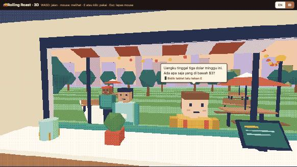
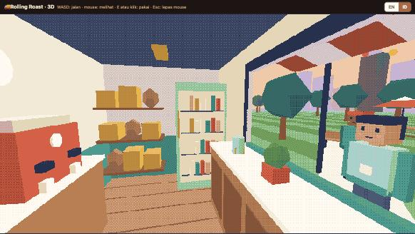
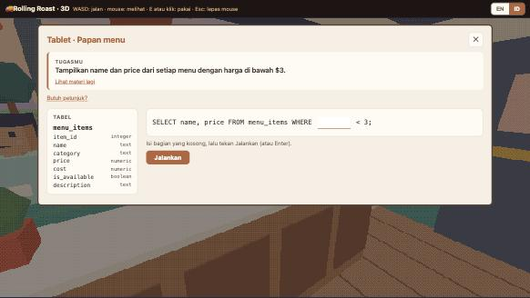
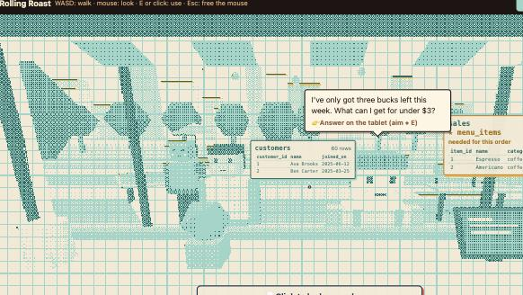

# SQL Valley

A first-person 3D game for learning SQL: you run a food truck in a city park, and every customer at the window brings a request you answer with SQL. Built around **thinking like a Business Intelligence (BI) analyst**, in a risograph-print look.



## Why this project exists

- **SQLBolt** has a great, easy-to-follow learning curve, but it isn't very interactive or fun.
- **LeetCode** is interactive, but many of its case-study problems jump too far in difficulty for beginners.

SQL Valley sits in between: step-by-step lessons like SQLBolt, wrapped in game mechanics that make you want to keep going, and ending with the skill real data jobs need: **answering business questions with data**.

## The concept

You are the new hire at **Rolling Roast**, a coffee food truck parked in a city park. Customers walk up the park path and queue at your window. Each one asks for something ("what can I get for under $3?", "which coffees can I actually order today?"), and you answer by writing SQL on the truck's tablet. Later, **The Manager** in a suit knocks on the back door with harder questions: sales this month, what keeps selling out, why revenue dropped.

- Runs entirely in the browser: real **PostgreSQL** via PGlite, no backend
- From `SELECT` to `JOIN`s, aggregation and real analysis cases
- Questions come back on later days, so you practise until queries stick
- Play in **English** or **Bahasa Indonesia** (SQL, table names and data always stay in English)

## How to play

1. Click the screen to look around (**Esc** frees the mouse).
2. **WASD** or the arrow keys to walk around the truck, the **mouse** to look.
3. Aim the crosshair at something and press **E** (or click). Each object sees its own tables: the **tablet** (sales, customers, menu), the **fridge** (stock, suppliers), the **menu board** and the **recipe binders**. The speech bubble tells you where to answer each order; any other object lets you look around its data freely.
4. Press **L** (or 🔍 Data Lens) to see the data behind everything: the truck turns into a blueprint and every object shows its tables, with the ones the current order needs starred.
5. Read the customer's request, write SQL, press **Run** (or Ctrl/⌘ + Enter). Your *result* is graded, not your text, with specific feedback when it isn't right yet.
6. **Hand over the order**, and the next customer steps up. Time stops while the tablet is open.

| Inside the truck | The tablet |
|---|---|
|  |  |

## The look

Everything is drawn through a **risograph shader**: the 3D scene is rendered at a low resolution, every pixel is mapped to a small set of riso inks with a 4×4 Bayer dither, ink outlines are drawn where depth jumps, and a red copy of each outline is printed one pixel off, like a riso print whose red layer didn't line up. The models are simple low-poly placeholders for now (see [docs/ASSETS.md](docs/ASSETS.md)).

**The Data Lens** turns the same picture into a teal blueprint: the world dissolves pixel by pixel, and a card floats over every object with its tables, row counts and sample rows.



## Status

🚧 **Phase 4: the one-day prototype.** The 3D truck, the park, the queue, the riso look, and objects that each open their own tables, and the Data Lens are in. Next: sales going into the database, the clock and the end-of-day summary, and The Manager.

The SQL core is complete from the first version of the game: 34 levels in six chapters (from `SELECT` to an analysis case), Mini Cases, a Skill Check and a timed mode. Phase 6 turns them into customer orders and manager questions over six in-game weeks.

- [GAME_DESIGN.md](GAME_DESIGN.md): the full design and roadmap
- [docs/JOURNEY.md](docs/JOURNEY.md): how the game went from a top-down 2D café to a 3D food truck, with screenshots

## Getting started

Requires Node.js 22+.

```bash
npm install
npm run dev        # start the dev server at http://localhost:5173
npm test           # run the tests
npm run build      # typecheck and build for production
npm run preview    # serve the production build at http://localhost:4173
```

## Tech stack

| Part | Choice |
|---|---|
| 3D world | [Three.js](https://threejs.org/) with a custom risograph post-processing shader (about 130 KB gzipped, loaded on demand) |
| SQL tablet and overlays | React 19 + [CodeMirror 6](https://codemirror.net/) (SQL highlighting and autocomplete) |
| Database | [PGlite](https://pglite.dev/): real PostgreSQL in the browser, running in a Web Worker so a slow query can be stopped |
| Language and tooling | TypeScript, Vite, Vitest |

How answers are kept safe and fair:

- Every query runs in a **read-only transaction** that is always rolled back, so the data can never be changed.
- Each part of the truck runs as its own **PostgreSQL role** that may only read its own tables.
- The checker compares **results**, not query text: any correct way of writing it counts. Row order only matters when the task asks for it.

## Project structure

```
src/
├── sql-core/      # the SQL "brain": no UI or game-engine code allowed here
│   ├── db.ts        # PGlite database, roles and the safe, read-only query runner
│   ├── stations.ts  # which tables each console can see
│   ├── checker.ts   # compares the player's result with the solution
│   ├── cases.ts     # case conclusions and evidence
│   ├── skillCheck.ts, rushHour.ts
│   ├── feedback.ts  # feedback messages in English and Indonesian
│   ├── data/        # the truck's data: menu, generated sales, recipes, stock (seeded, always the same)
│   ├── levels/      # chapters, levels and their translations (locales/id)
│   └── truck/       # customer orders (locales/id for translations)
├── console/       # SQL console UI (React): blocks, fill-in-the-blank, editor, case notes
├── game/          # the 3D world (Three.js): no React code allowed here
│   ├── art/riso.ts  # the riso inks
│   └── truck/       # world layout, models, riso shader, queue, the game loop, and the bridge to React
├── app/           # the page around the world: HUD, tablet, the shift's logic, the database worker
└── i18n.ts        # UI text in both languages
docs/
├── JOURNEY.md     # the design journey, with screenshots
├── ASSETS.md      # which art is final and which is a placeholder
└── journey/       # screenshots
```

## Credits

No third-party art is used yet: the palette, models and shader are original. See [CREDITS.md](CREDITS.md).
