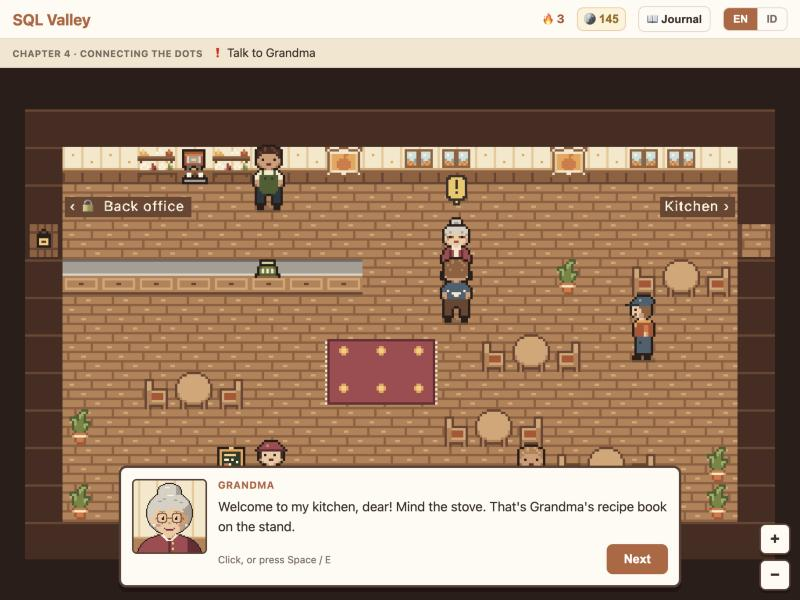
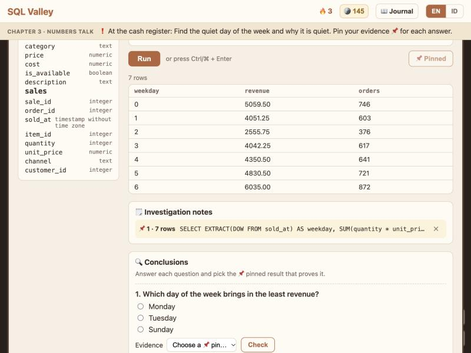

# SQL Valley

An interactive top-down game for learning SQL — fun to play, with a gentle learning curve, and built around **thinking like a Business Intelligence (BI) analyst**.


*The front room with every café upgrade bought. A new game starts with a plainer café: you earn coins from stars and spend them in the upgrade shop (tap 🪙) to add the rug, tables, plants and customers.*

## Why this project exists

- **SQLBolt** has a great, easy-to-follow learning curve, but it isn't very interactive or fun.
- **LeetCode** is interactive, but many of its case-study problems jump too far in difficulty for beginners.

SQL Valley sits in between: step-by-step lessons like SQLBolt, wrapped in game mechanics that make you want to keep going — and ending with the skill real data jobs need: **answering business questions with data**.

## The concept

You inherit your grandma's struggling café and become its data analyst. Explore the café in a 2D top-down world, take on requests from the people around you, and solve them with SQL at consoles found at the menu board, the cash register, the kitchen, the storeroom and the back office — from "show me the menu" all the way to "sales dropped last month, why?".

- Web game that runs entirely in the browser
- Queries run on a real PostgreSQL database in the browser (PGlite) — no backend needed
- Progresses from basic `SELECT` to `JOIN`s, aggregation, and real business analysis cases
- Play in **English** or **Bahasa Indonesia** (SQL, table names and data always stay in English)

## How to play

1. **Talk** to whoever has a golden **!** above their head. They ask for something — a list, a number, an answer.
2. **Walk to the station** the "!" moves to. Each station's console only sees its own tables, like real company systems: the menu board sees the menu, the cash register sees the sales.
3. **Write SQL**, press **Run** (or Ctrl/⌘ + Enter). Your *result* is graded, not your text, with specific feedback when it's not right yet.
4. **Report back** and earn stars ⭐ and coins 🪙. Spend coins to make the café cosier.

Controls: WASD / arrow keys or click/tap to walk, **E** / Space to talk or use a station, − / + to zoom. The 📖 Journal has your levels, a café map and your badges.

| Talk to the café's people | Investigate like an analyst |
|---|---|
|  |  |

**Mini Cases** have no single right query: run as many queries as you like, pin 📌 the results that prove your answers, and draw conclusions — like a real analyst.


## What's inside

- **Six chapters, 34 levels**: 0 · First Day · 1 · Cleaning Up the Menu · 2 · First Reports · 3 · Numbers Talk · 4 · Connecting the Dots · 5 · The Analysis Case
- Input that grows with you: word blocks → fill in the blanks → a full SQL editor with autocomplete
- **Mini Cases** at the end of Chapters 1–4, and the big **Analysis Case** to finish: *"October sales dropped 18%. What happened?"*
- **"So what?"** questions after some levels: what does this result actually mean?
- **Four rooms** that open chapter by chapter: the front room, the kitchen, the storeroom and the back office
- **A café that grows**: stars, coins, upgrades (plants, a rug, tables, a fancy menu board, strolling customers), a daily streak 🔥 and badges 🏅
- **Skill Check** for players who already know some SQL, and **Rush Hour** ⏱, a timed challenge
- Realistic café data made by a seeded generator: about 4,600 orders from August to October, with hidden patterns to discover
- Warm autumn pixel art: original characters, plus furniture from Kenney's CC0 pack (see [CREDITS.md](CREDITS.md))

## Status

✅ **The MVP is complete**: Phase 1 (SQL core), Phase 2 (the first world) and Phase 3 (the café grows) are done.
A [playtest checklist](docs/PLAYTEST.md) is kept for checking the whole game by hand.

See [GAME_DESIGN.md](GAME_DESIGN.md) for the full design and roadmap (written in Indonesian).

## Getting started

Requires Node.js 22+.

```bash
npm install
npm run dev        # start the dev server at http://localhost:5173
npm test           # run the tests
npm run build      # typecheck and build for production
npm run preview    # serve the production build at http://localhost:4173
```

While developing, add `?level=` to jump straight to a level's request, e.g. `http://localhost:5173/?level=ch5-3` for the Analysis Case. Journal → **Start over** resets your progress.

## Tech stack

| Part | Choice |
|---|---|
| Game world | [Phaser 3](https://phaser.io/) (2D, pixel art at whole-number zoom) |
| SQL consoles and overlays | React 19 + [CodeMirror 6](https://codemirror.net/) (SQL highlighting and autocomplete) |
| Database | [PGlite](https://pglite.dev/) — real PostgreSQL in the browser, running in a Web Worker so a slow query can be stopped |
| Language and tooling | TypeScript, Vite, Vitest (about 480 automated tests) |

How answers are kept safe and fair:

- Every query runs in a **read-only transaction** that is always rolled back, so the café's data can never be changed.
- Each station runs as its own **PostgreSQL role** that may only read its own tables.
- The checker compares **results**, not query text: any correct way of writing it counts. Row order only matters when the task asks for it.

## Project structure

```
src/
├── sql-core/      # the SQL "brain" — no UI or game-engine code allowed here
│   ├── db.ts        # PGlite database, station roles and the safe, read-only query runner
│   ├── stations.ts  # which tables each station's console can see
│   ├── checker.ts   # compares the player's result with the solution
│   ├── cases.ts     # Mini Case / Analysis Case conclusions and evidence
│   ├── skillCheck.ts, rushHour.ts
│   ├── feedback.ts  # feedback messages in English and Indonesian
│   ├── data/        # café data: menu, generated sales, recipes, stock (seeded, always the same)
│   └── levels/      # chapters, levels and their translations (locales/id)
├── console/       # SQL console UI (React): blocks, fill-in-the-blank, editor, Mini Case notes
├── game/          # the 2D world (Phaser) — no React code allowed here
│   ├── rooms/       # the café map as text (one character = one 16×16 tile), rooms and upgrades
│   ├── art/         # pixel art as text grids in one 32-colour palette
│   ├── sheet.ts     # how a character's walking sheet is laid out
│   └── bridge.ts    # the only link between the game world and the React overlays
├── app/           # the page around the world: overlays, quests, rewards, growth, the database worker
└── i18n.ts        # UI text in both languages
docs/
├── images/        # screenshots for this README
└── PLAYTEST.md    # the checklist for playtesting
```

## Credits

Furniture tiles from [Kenney's Roguelike Indoors](https://kenney.nl/assets/roguelike-indoors) (CC0). Everything else — the palette, the characters, portraits and the rest of the tiles — is original. See [CREDITS.md](CREDITS.md).
