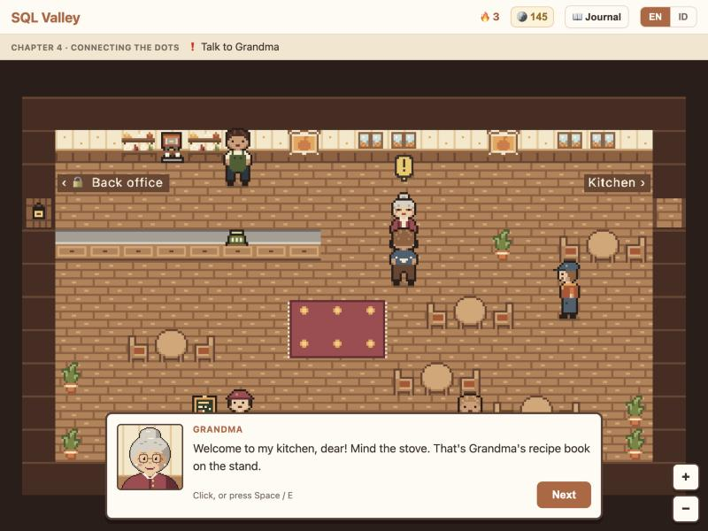
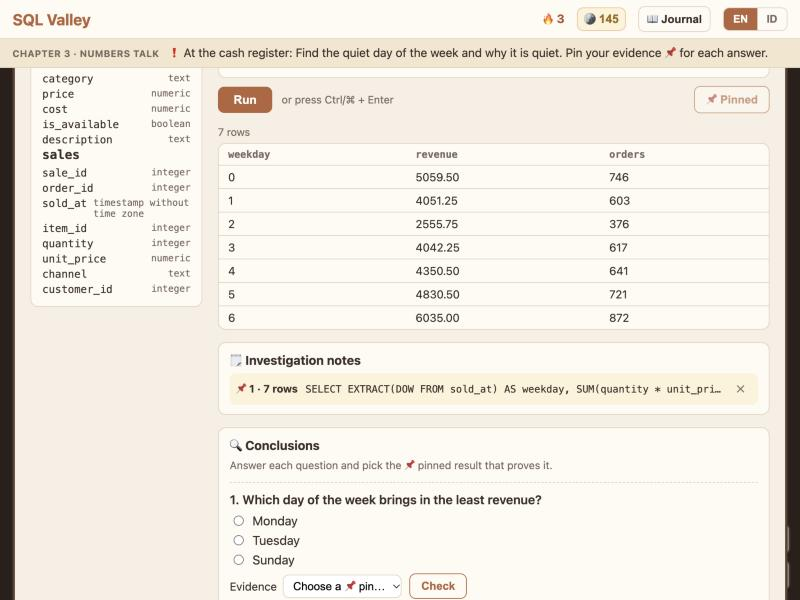
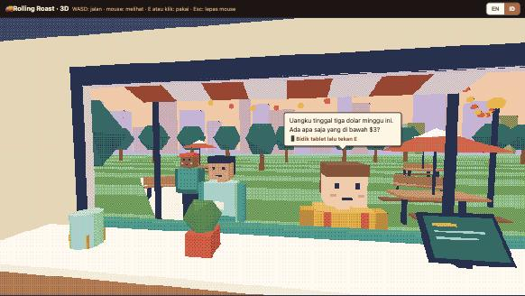
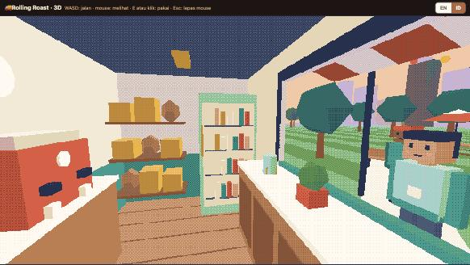

# Perjalanan Desain SQL Valley

Dokumentasi bagaimana SQL Valley berubah dari **kafe top-down 2D** menjadi **food truck 3D orang pertama bergaya risograf**: setiap tahap, apa yang dibangun, kenapa berubah, dan apa yang dipelajari. Ditulis 17 November 2026, saat versi 3D ditetapkan sebagai konsep tetap.

> Semua versi lama tetap bisa dibuka dari git:
> - `git checkout v1-cafe-mvp` — kafe top-down (MVP v1, Fase 1–3)
> - `git checkout v2-prototypes` — semua prototipe food truck (2D 4.1–4.5 dan 3D 4.6)
>
> Kembali ke versi terbaru: `git checkout main`.

---

## Ringkasan

| Tahap | Tanggal | Tampilan | Kenapa ditinggalkan / dilanjutkan |
|---|---|---|---|
| **v1 · Kafe top-down** (Fase 1–3) | 13–16 Nov | 2D pixel art, kamera dari atas, berjalan ke stasiun | MVP lengkap, tapi pemilik project ingin konsep baru yang lebih fokus |
| **4.1 · Truck statis** | 16 Nov | 2D satu layar, tampak dari dalam truck | Terlalu kecil dan diam |
| **4.2–4.3 · Antrean + tablet** | 16 Nov | Sama, ditambah pelanggan dan tablet SQL | Alur pesanan terbukti jalan; tampilan masih kurang |
| **4.4 · Truck dijelajahi** | 16 Nov | 2D tampak samping, berjalan WASD, kamera mengikuti | "Tidak sesuai": ingin orang pertama, dan gaya terlalu generik |
| **4.5 · Orang pertama + risograf** | 17 Nov | 2D panorama 4 sisi, taman, gaya cetak risograf | "Oke tapi kurang greget"; ingin 3D yang bisa jalan |
| **4.6 · Prototipe 3D** ✅ | 17 Nov | 3D low-poly orang pertama + shader risograf | **Ditetapkan sebagai konsep tetap** |

---

## v1 · Kafe warisan Grandma (Fase 1–3)

**Konsep:** pemain mewarisi kafe Grandma di lembah dan menjadi analis data keluarga. Pemain berjalan di kafe top-down, berbicara dengan tokoh (Grandma, Barista, Regular, Supplier), lalu membuka konsol SQL di stasiun tertentu (Menu board, Cash register, Recipe book, Stock ledger, Back office).

**Yang dibangun:** Chapter 0–5 (34 level, termasuk 4 Mini Case dan Analysis Case "October sales dropped 18%"), PostgreSQL di browser (PGlite), pengecek jawaban, input bertahap (blok → isi kosong → ketik bebas), EN/ID, bintang/koin/upgrade/streak/badge, Skill Check, Rush Hour, dan 477 tes otomatis.

| | |
|---|---|
|  |  |
|  |  |

**Kenapa berubah:** MVP sudah lengkap, tetapi pemilik project punya gagasan yang lebih kuat: food truck dengan jam buka, pelanggan yang antre membawa pesanan (tugas SQL), pengulangan agar query tidak mudah lupa, dan manajer yang menanyakan penjualan. Tugas datang sendiri, sehingga pemain tidak perlu berjalan jauh ke stasiun.

**Yang dipertahankan:** seluruh **inti SQL** (database, pengecek jawaban, data level, terjemahan) dan **konsol SQL**. Keputusan arsitektur v1 untuk memisahkan inti SQL dari dunia game membuat semua perubahan berikutnya murah.

---

## 4.1 · Food truck statis

Satu adegan 2D 480×270 yang dilihat dari dalam truck: jendela saji dengan awning, kota di luar, counter dengan tablet, papan menu, jam, dan pintu belakang. Grandma dan semua tokoh v1 dihapus atas permintaan pemilik project, diganti **The Manager** berjas yang bossy (belum digambar).

**Pelajaran:** zoom bilangan bulat menjaga piksel tetap tajam, tetapi satu layar statis terasa kosong.

---

## 4.2–4.3 · Antrean pelanggan dan tablet SQL

Lima pelanggan baru datang, antre, dan yang terdepan menyampaikan pesanan dalam gelembung (EN/ID). Pesanan memakai soal Chapter 1. Tablet membuka konsol SQL v1. Waktu berhenti saat tablet terbuka, dan jawaban benar membuat pelanggan dilayani dan antrean maju.

**Pelajaran:** **alur inti game terbukti**: pesanan → tablet → SQL → dilayani. Logika antrean (`queue.ts`) dan pesanan (`orders.ts`) ditulis tanpa engine, sehingga dipakai terus sampai versi 3D. Tes otomatis menemukan bug nyata: dua pelanggan bisa muncul bertumpuk.

**Masukan pemilik project:** "Jelek dan kurang… terlalu kecil dan minim interaksi, tidak ada camera movement."

---

## 4.4 · Truck yang bisa dijelajahi (tampak samping)

Interior 2D selebar dua layar. Pemain besar berjalan dengan WASD, kamera mengikuti, dan pelanggan setengah badan terlihat di jendela. Tanda **E** muncul di dekat benda. Tombol 🏷 menampilkan label **PLACEHOLDER** pada semua gambar sementara (daftarnya di `docs/ASSETS.md`).

**Masukan pemilik project:** ingin **orang pertama**, dan gaya visualnya **terlalu generik, tidak memorable, main aman**. Latar gedung diminta diganti menjadi **taman** dengan tempat duduk yang nanti ramai bila bisnis ramai.

---

## 4.5 · Orang pertama, taman, dan gaya risograf

Panorama 2D empat sisi (kulkas & stok, jendela saji, dapur, pintu belakang). Pemain menoleh dengan A/D atau tombol ‹ ›, menyorot benda dengan kursor, dan mengklik untuk memakainya. Di luar jendela ada taman berlapis dengan parallax: langit senja, siluet kota jauh, pohon, jalan setapak, bangku, dan meja piknik. Pelanggan antre dengan perspektif (makin jauh, makin kecil).

Lahir **gaya cetak risograf**: tinta terbatas di atas kertas krem, bayangan dari pola titik (dither), dan garis merah yang "meleset" 1 piksel seperti hasil cetak riso.

| | |
|---|---|
|  |  |

**Masukan pemilik project:** "Oke, tapi kurang greget." Yang sebenarnya diinginkan adalah **3D yang bisa jalan WASD**. Kekhawatirannya: apakah game web jadi berat?

**Jawaban:** tidak. Three.js hanya ±150 KB, jauh lebih kecil dari database SQL (±10 MB). Aset 3D gratis (CC0) justru lebih banyak dan lebih bagus daripada karakter 2D besar.

---

## 4.6 · Prototipe 3D ✅ (konsep tetap)

Dunia 3D low-poly dengan **Three.js**. Pemain berjalan di dalam truck dengan **WASD**, melihat dengan **mouse**, lalu membidik benda dan menekan **E**. Pelanggan 3D berjalan di jalan setapak taman, antre, lalu berbalik menghadap truck. Gelembung pesanan menempel di kepala pelanggan terdepan.

Ciri khasnya, **shader risograf**: adegan dirender berpiksel besar, warnanya dipetakan ke tinta riso dengan dither Bayer 4×4, ada garis tepi tinta, dan garis merah yang meleset. Hasilnya seperti **poster risograf yang bisa dijelajahi**.

| | |
|---|---|
|  |  |

**Masukan pemilik project:** *"That is so sickkk, keren banget!"* → 3D ditetapkan sebagai konsep besar game.

**Pelajaran teknis:**
- Three.js versi baru memakai **satuan lampu fisik**: intensitas lampu harus dikali π, kalau tidak semua objek tergambar terlalu gelap.
- Warna tinta harus dipakai **persis** (tanpa konversi sRGB → linear) di adegan maupun di shader. Kalau tidak, warna dipetakan ke tinta yang salah dan semuanya jadi kehijauan.
- Seluruh kode 3D hanya **127 KB** terkompresi.

---

## Yang dibawa ke versi tetap

| Dari | Dipakai di versi 3D |
|---|---|
| v1 | Inti SQL (PGlite, pengecek jawaban, 34 level, terjemahan, Skill Check, Rush Hour), konsol SQL, sistem bahasa EN/ID |
| 4.2–4.3 | Antrean pelanggan (`queue.ts`), daftar pesanan (`orders.ts`), alur tablet |
| 4.4 | Penandaan aset sementara (`docs/ASSETS.md`) |
| 4.5 | Palet & gaya risograf (`riso.ts`), konsep taman yang ramai bila bisnis ramai, empat area truck (kulkas, jendela, dapur, pintu) |
| 4.6 | Semuanya: dunia 3D, kontrol, shader |

## Pelajaran proses

1. **Pisahkan inti dari tampilan.** Karena inti SQL tidak bergantung pada engine game, tampilan bisa diganti lima kali tanpa menyentuh logika SQL.
2. **Prototipe kecil dulu, bongkar belakangan.** Setiap arah baru dibuka lewat alamat terpisah (`?truck`, `?truck3d`) sehingga versi lama tidak rusak sampai versi baru terbukti.
3. **Masukan yang jujur mempercepat.** "Jelek", "kurang greget", dan "jangan main aman" adalah arahan yang langsung mengubah keputusan desain.
4. **Pilih gaya yang cocok dengan cara membuatnya.** Gaya risograf (bentuk datar, tinta terbatas) cocok digambar lewat kode maupun shader. Karena itulah prototipe tetap terlihat khas walaupun asetnya masih sementara.
