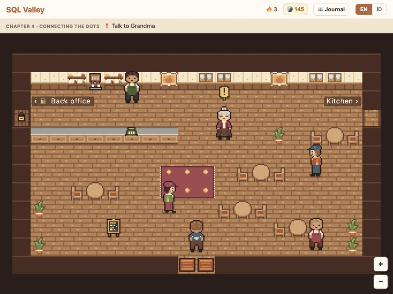
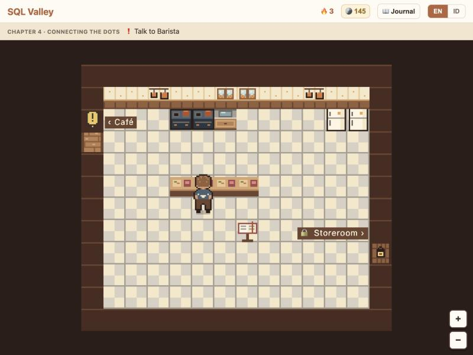
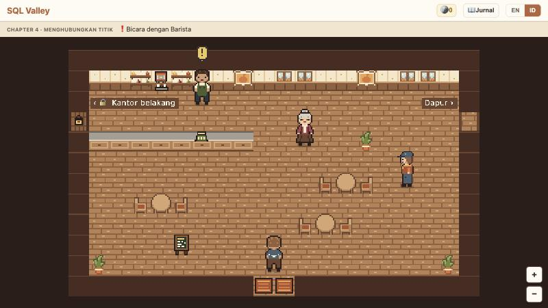
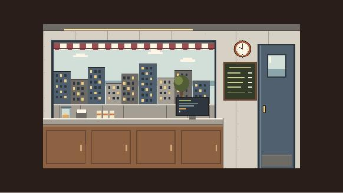
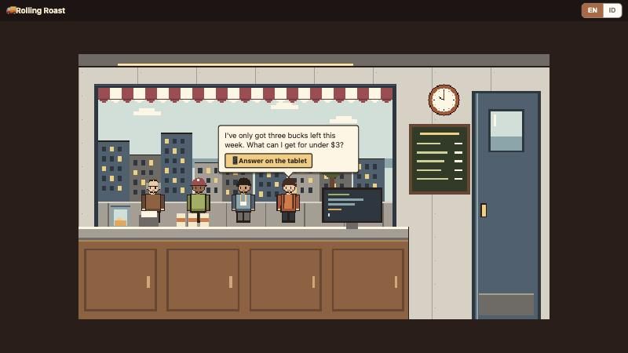
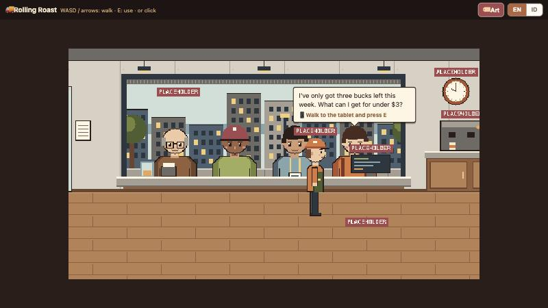
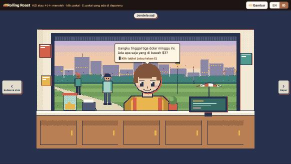
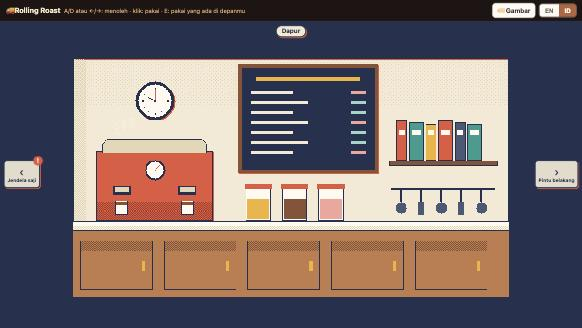
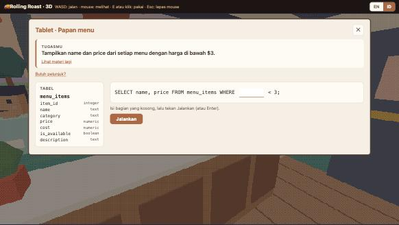

# The Design Journey of SQL Valley

How SQL Valley changed from a **top-down 2D café** into a **first-person 3D food truck in a risograph style**: every stage, what was built, why it changed, and what we learned. Written on 17 November 2026, when the 3D version was locked in.

> Every old version can still be opened from git:
> - `git checkout v1-cafe-mvp` — the top-down café (v1 MVP, Phases 1–3)
> - `git checkout v2-prototypes` — every food truck prototype (2D 4.1–4.5 and 3D 4.6)
>
> Back to the latest version: `git checkout main`.

---

## Summary

| Stage | Date | Look | Why it was left behind / kept |
|---|---|---|---|
| **v1 · Top-down café** (Phases 1–3) | 13–16 Nov | 2D pixel art, camera from above, walk to stations | A complete MVP, but the owner wanted a new, more focused concept |
| **4.1 · Static truck** | 16 Nov | 2D, one screen, seen from inside the truck | Too small and too still |
| **4.2–4.3 · Queue + tablet** | 16 Nov | Same, plus customers and an SQL tablet | The order loop worked; the look still fell short |
| **4.4 · A truck to walk around** | 16 Nov | 2D side view, WASD walking, following camera | "Not what I want": the owner wanted first person, and the style felt generic |
| **4.5 · First person + risograph** | 17 Nov | A 2D panorama of four sides, a park, a risograph-print style | "Okay, but not exciting enough"; the owner wanted 3D with walking |
| **4.6 · 3D prototype** ✅ | 17 Nov | First-person low-poly 3D + a risograph shader | **Locked in as the game's concept** |

---

## v1 · Grandma's café (Phases 1–3)

**Concept:** the player inherits Grandma's café in a valley and becomes the family's data analyst. They walk around a top-down café, talk to people (Grandma, the Barista, a Regular, the Supplier) and open an SQL console at a station (Menu board, Cash register, Recipe book, Stock ledger, Back office).

**What was built:** Chapters 0–5 (34 levels, including 4 Mini Cases and the Analysis Case "October sales dropped 18%"), PostgreSQL in the browser (PGlite), the answer checker, input that grows (blocks → fill in the blanks → free typing), English and Indonesian, stars/coins/upgrades/streaks/badges, a Skill Check, Rush Hour, and 477 automated tests.

| | |
|---|---|
|  |  |
|  |  |

**Why it changed:** the MVP was complete, but the owner had a stronger idea: a food truck with opening hours, customers who queue with orders (SQL tasks), repetition so queries are not forgotten, and a manager who asks about sales. Tasks come to the player, so there is no long walk to a station.

**What was kept:** the whole **SQL core** (database, answer checker, level data, translations) and the **SQL console**. v1's decision to keep the SQL core separate from the game world made every later change cheap.

---

## 4.1 · A static food truck

One 2D scene, 480×270, seen from inside the truck: a serving window with an awning, the city outside, a counter with a tablet, a menu board, a clock and a back door. Grandma and every v1 character were dropped at the owner's request, replaced by **The Manager**, a bossy boss in a suit (not drawn yet).

**Lesson:** whole-number zoom keeps pixels sharp, but one still screen feels empty.

---

## 4.2–4.3 · The customer queue and the SQL tablet

Five new customers arrive, queue up, and the one at the front says their order in a speech bubble (English or Indonesian). Orders use Chapter 1's questions. The tablet opens v1's SQL console. Time stops while the tablet is open, and a correct answer serves the customer and moves the queue along.

**Lesson:** **the game's core loop works**: order → tablet → SQL → served. The queue logic (`queue.ts`) and the orders (`orders.ts`) were written without an engine, so they lasted all the way to the 3D version. The automated tests caught a real bug: two customers could appear on top of each other.

**Owner's feedback:** "Ugly and lacking… too small, hardly any interaction, no camera movement."

---

## 4.4 · A truck you can walk around (side view)

A 2D interior two screens wide. A big player character walks with WASD, the camera follows, and half-body customers show in the window. An **E** prompt appears near objects. A 🏷 button shows **PLACEHOLDER** labels on every temporary picture (listed in `docs/ASSETS.md`).

**Owner's feedback:** wanted **first person**, and found the visual style **too generic, not memorable, playing it safe**. The city buildings outside should become a **park**, with seats that fill up when business is good.

---

## 4.5 · First person, a park, and the risograph style

A 2D panorama of four sides (fridge & stock, serving window, kitchen, back door). The player turns with A/D or the ‹ › buttons, highlights objects with the cursor and clicks to use them. Outside the window, a layered park with parallax: a dusk sky, a faint distant city, trees, a path, benches and picnic tables. Customers queue in perspective: the further away, the smaller.

The **risograph-print style** was born here: a few inks on cream paper, shading from dotted patterns (dither), and red outlines that are one pixel "off", like a riso print.

| | |
|---|---|
|  |  |

**Owner's feedback:** "It's okay, but not exciting enough." What they really wanted was **3D with WASD walking**, and they worried a web game would become too heavy.

**The answer:** it does not. Three.js is about 150 KB, far smaller than the SQL database (about 10 MB). Free (CC0) 3D assets are also more plentiful and better than big 2D characters.

---

## 4.6 · 3D prototype ✅ (locked in)

A low-poly 3D world with **Three.js**. The player walks inside the truck with **WASD**, looks with the **mouse**, aims at an object and presses **E**. 3D customers walk up the park path, queue, then turn to face the truck. The speech bubble follows the head of the customer at the window.

The signature look is the **risograph shader**: the scene is rendered with big pixels, its colours are mapped to the riso inks with a 4×4 Bayer dither, ink outlines are drawn, and a red copy of each outline is printed one pixel off. The result looks like **a risograph poster you can walk around in**.

| | |
|---|---|
|  |  |

**Owner's feedback:** *"That is so sickkk, keren banget!"* → 3D was locked in as the game's big concept.

**Technical lessons:**
- Recent Three.js versions use **physical light units**: light intensities must be multiplied by π, or everything renders far too dark.
- Ink colours must be used **exactly as written** (no sRGB → linear conversion) in both the scene and the shader. Otherwise colours map to the wrong ink and everything turns green.
- All the 3D code is only **127 KB** gzipped.

---

## What carried over into the final version

| From | Used in the 3D version |
|---|---|
| v1 | The SQL core (PGlite, answer checker, 34 levels, translations, Skill Check, Rush Hour), the SQL console, the English/Indonesian language system |
| 4.2–4.3 | The customer queue (`queue.ts`), the order list (`orders.ts`), the tablet flow |
| 4.4 | Marking temporary art (`docs/ASSETS.md`) |
| 4.5 | The riso palette and style (`riso.ts`), the park that fills up when business is good, the four areas of the truck (fridge, window, kitchen, door) |
| 4.6 | Everything: the 3D world, the controls, the shader |

## Lessons about the process

1. **Keep the core separate from the look.** Because the SQL core does not depend on the game engine, the look could be replaced five times without touching the SQL logic.
2. **Prototype small, remove later.** Each new direction opened at its own address (`?truck`, `?truck3d`), so old versions kept working until the new one proved itself.
3. **Honest feedback speeds things up.** "Ugly", "not exciting enough" and "don't play it safe" were direct instructions that changed design decisions.
4. **Pick a style that suits how it is made.** The risograph style (flat shapes, few inks) works well both drawn in code and in a shader. That is why the prototype looks distinctive even with placeholder art.
